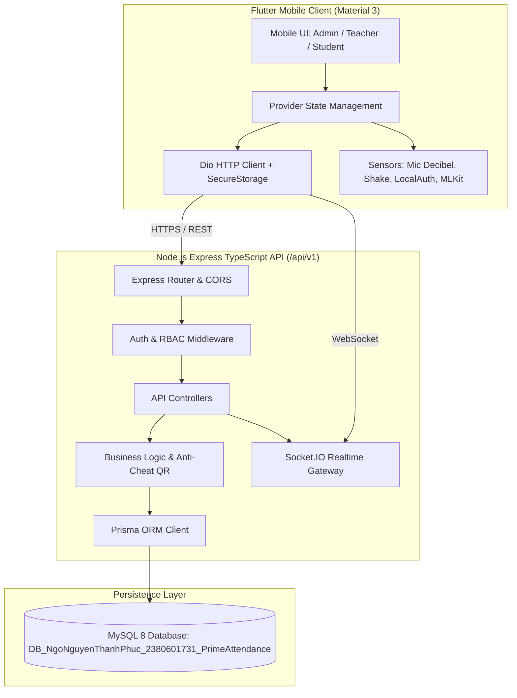

# PRIME Attendance Implementation Plan

> **For agentic workers:** REQUIRED SUB-SKILL: Use superpowers:subagent-driven-development to implement this plan task-by-task. Steps use checkbox (`- [ ]`) syntax for tracking.

**Goal:** Xây dựng hoàn chỉnh hệ thống điểm danh sinh viên PRIME Attendance gồm Backend Node.js/TypeScript REST API với xác thực 3 bước OTP, phân quyền 3 vai trò, dynamic anti-cheat QR 10s nonce, Prisma MySQL 8, Flutter client Material 3 với giao diện Indigo/Blue, cảm biến độ ồn, cử chỉ lắc, sinh trắc học, OCR giấy tờ, Docker container hóa và kiểm thử tự động.

**Architecture:** 
- Backend Node.js / Express / TypeScript theo kiến trúc phân tầng (Routes -> Controllers -> Services -> Prisma ORM -> MySQL). Realtime Socket.IO cho điểm danh.
- Frontend Flutter Material 3 kiến trúc Provider + Repository + Dio Client + GoRouter.
- Hệ thống bảo mật: Argon2id password hash, OTP SHA-256 mã hóa, HMAC-SHA256 signed QR payload với 10s TTL và one-time nonce.

**Architecture Diagram:**

**Tech Stack:** 
- Backend: Node.js LTS, Express 4/5, TypeScript, Prisma ORM, MySQL 8, Argon2, jsonwebtoken, nodemailer, socket.io, swagger-ui-express, multer, jest, supertest.
- Frontend: Flutter 3.47+, Dart 3.13+, provider, dio, go_router, flutter_secure_storage, mobile_scanner, local_auth, noise_meter, sensors_plus, google_mlkit_text_recognition, google_mlkit_translation.
- Infra: Docker Compose, Nginx/Caddy, GitHub Actions.

**Spec:** [docs/superpowers/specs/2026-10-21-prime-attendance-design.md](file:///c:/Users/ASUS/Desktop/appdiemdanh/docs/superpowers/specs/2026-10-21-prime-attendance-design.md)

## Global Constraints
- Database Name: `DB_NgoNguyenThanhPhuc_2380601731_PrimeAttendance`
- Student ID: `2380601731`
- Student Name: `Ngo Nguyen Thanh Phuc`
- GitHub Repo: `phucngo1707/ngonguyenthanhphuc_prime_diemdanh`
- API prefix: `/api/v1`
- QR dynamic token duration: 10 seconds
- Password hash: Argon2id
- Mobile UI: Material 3, Indigo/Blue theme

---

### Task 1: Repository Restructuring & Git Workspace Setup
Move root Flutter files into `mobile/`, setup folders `api/`, `infra/`, `docs/`, `scripts/`, `.github/workflows/`.
Push initial commit to GitHub `phucngo1707/ngonguyenthanhphuc_prime_diemdanh`.

### Task 2: Backend Project Scaffolding & MySQL 8 Environment Setup
Initialize `api/` with `package.json`, `tsconfig.json`, Prisma CLI, Express, TypeScript dependencies.
Spin up MySQL 8 in Docker with database `DB_NgoNguyenThanhPhuc_2380601731_PrimeAttendance`.

### Task 3: Prisma Schema Modeling (15 Tables) & Migration & Seed Data
Write `prisma/schema.prisma` with 15 required tables, foreign keys, unique constraints.
Run `prisma migrate dev` and `prisma db seed` with demo users (Admin, Teacher, Student) and sample academic data.

### Task 4: Core Authentication & RBAC Module
Implement Argon2id password hashing, 3-step auth (credentials -> email OTP -> JWT pair).
Implement Demo Account bypass for seeded accounts with fixed OTP (`DEMO_FIXED_OTP=170723`).
Implement RBAC middleware (`ADMIN`, `TEACHER`, `STUDENT`).

### Task 5: Academic & Class Section CRUD Module (CRUD 1)
Implement faculties, subjects, classrooms, and class sections CRUD with teacher assignments and student enrollments.

### Task 6: Attendance Session & Dynamic Anti-Cheat QR Module (CRUD 2)
Implement session creation, open, close, auto-expiration (15m).
Implement HMAC-SHA256 signed QR payload with 10s timestamp TTL and single-use nonce cache.
Integrate Socket.IO realtime session updates.

### Task 7: Attendance Record & Manual Adjustments Module (CRUD 3)
Implement QR check-in verification endpoint with anti-cheat checks, prevent replay, prevent duplicate check-in.
Implement teacher manual attendance override with audit logs.

### Task 8: Leave Requests & File Attachments Module (CRUD 4)
Implement leave request submission with attachment upload (multer), teacher review/approval, and audit logging.

### Task 9: Auxiliary Endpoints (Noise Logs, NFC Tags, Health Checks, Swagger)
Implement `/health` and `/health/ready` endpoints.
Implement Swagger documentation at `/api-docs`.

### Task 10: Backend Integration & Unit Tests Suite
Write Jest + Supertest test cases for Auth, RBAC, Class CRUD, QR Anti-cheat, Leave requests, and Health checks. Run and pass 100%.

### Task 11: Flutter Application Foundation & UI Design System
Update `mobile/pubspec.yaml`, configure Material 3 theme with Indigo/Blue palette, Dio client, GoRouter, Secure Storage, and Auth State Provider.

### Task 12: Flutter Authentication Flow & Demo Quick-Login
Build Splash, Login Screen, OTP Verification Screen with demo account buttons for fast evaluation.

### Task 13: Flutter Role-Based Dashboards & Management Screens
Build Admin Dashboard (CRUD faculties, subjects, classes, users).
Build Teacher Dashboard (Schedule, sessions, Dynamic QR generator with 10s countdown, real-time attendee list, leave review).
Build Student Dashboard (Timetable, QR Scanner, attendance history, leave request submission).

### Task 14: Mobile Sensors & AI Integration (D, E, F)
Implement Noise Meter sound level monitor in Teacher view.
Implement Accelerometer Shake detection for quick check-in shortcut in Student view.
Implement `local_auth` Biometric prompt prior to check-in.
Implement ML Kit Text Recognition (OCR) and Translation on leave request form.

### Task 15: Docker Containerization, VPS Deployment Config & Monitoring
Write multi-stage `Dockerfile` for API, `docker-compose.yml`, Caddy / Nginx reverse proxy configuration, automated backup & restore shell/PowerShell scripts, and GitHub Actions CI.

### Task 16: Documentation, Postman Collection & Verification Report
Generate Postman Collection v2.1.
Complete comprehensive Vietnamese `README.md` containing all 14 required sections.
Verify all features and generate final execution report.
